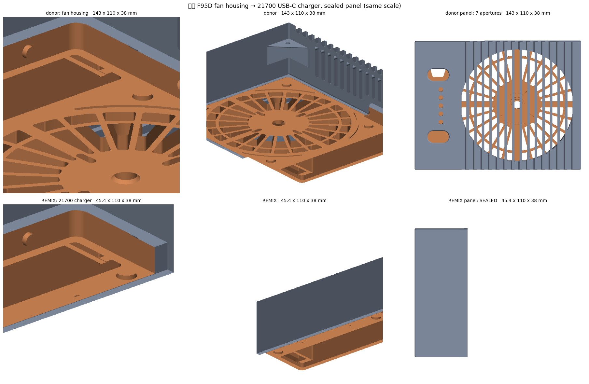

# f95d-21700-charger 🔋

**Agentic 3D modeling on someone else's file.** A 共田 F95D handheld fan died — motor gone,
motor-driver circuit gone — but its USB‑C charge path still worked. An AI agent (Claude) took a
third-party 3MF housing it had never seen, reverse-engineered the assembly, cut away the entire
fan, and rebuilt what was left into a **45 × 110 × 38 mm 21700 charger**. Every cut backed by a
number; the electronics bay provably untouched.

Geometry and verification by the agent; the dead fan, the prints, and the verdict by the human.
Part of the [evnchn-agentic](https://github.com/evnchn-agentic) agentic-3D-modeling line.

**Status: printed and working.** Not a draft — it was assembled, it charges, and the one open
question is that 5000 mAh is simply not much capacity.

---

## What it is

The donor housing is a boxy aftermarket shell for a 共田 F95D fan. It splits along a seam nobody
documented: everything on one side is fan — duct, motor boss, bearing seat, kickstand pivots,
grille — and everything on the other is a **control strip** carrying the PCB slot, a Ø22 21700
bore, a sliding battery door, the USB‑C pocket, two buttons and five LEDs.

Kill the fan side, keep the strip, close the wound. The result is **a quarter of the original
volume** and still charges the cell.

| | donor housing | this remix |
|---|---|---|
| assembled | 143 × 110 × 38 mm | **45.4 × 110 × 38 mm** |
| front shell | 159.3 cm³ | 71.7 cm³ |
| back shell | 58.8 cm³ | 28.6 cm³ |
| front support needed | 30.7 cm² | 2.2 cm² |

---

## The star: cutting a file you didn't author, safely

The hard part isn't the cut. It's proving the cut didn't disturb anything that has to fit real
hardware you can't re-measure.

**The assembly transform wasn't in the file.** The two shells are stored in their own coordinate
frames with no recorded relationship. It was recovered from the geometry: the two M3 screw axis
pairs both gave `dx = −1.495` from 85 mm apart, and that was cross-checked two independent ways —
the front boss's bottom face meets the back plate's top face exactly at `dz = −6.25`, and both
outer faces land flush. Interference at that transform: **1 vertex in 20 000**.

**The electronics bay is provably preserved.** Everything at X ≤ −38 — PCB slot, cell bore, door
rail, USB‑C aperture — is compared against the donor on every build. The back shell is
bit-identical (0.000000 mm³, 0.000000 mm deviation); the front differs by **416.01 mm³ against a
measured cap volume of 416.01 mm³**, i.e. the deliberate panel caps and nothing else.

**The screws moved, and that set the length.** Relocating the M3 pair 7.8 mm further in shortened
the case by 8.1 mm. It couldn't go further: the battery bay's own end wall sits at X = −40.0…−38.49
and a Ø8 boss has to clear it. There was nowhere else to put them — the 9 mm band outboard of the
bay is entirely consumed by the two nested shell walls, which are 0.2 mm apart.

**It holds together on more than screws.** The back's battery tower telescopes **16 mm into the
front's side walls at 0.200 mm clearance**, continuously along both long sides. The new end joint
reproduces the donor's own measured lid clearance of **0.195 mm** — measured, not assumed.

---

## Three bugs the checks caught before printing

Worth writing down, because two of them look green until you look properly.

**A mesh that `is_watertight` called fine but was broken.** The first working panel-cap version
reported watertight — and had 3 coincident-but-distinct vertices (euler −4). Index topology says
fine; the moment it's written to STL those merge into a pinch, and it came back with 8 broken
faces in *every* format tried. Cause: unioning only the extracted void, whose side walls were
exactly face-tangent to the aperture walls. Unioning the whole slab instead — so the added solid
*overlaps* the panel rather than touching it — fixed it. The check is now a **round-trip**: write
to STL, read back, require watertight with zero broken faces.

**A phantom hole that was a ray-tangency artifact.** A leak sweep reported 2 new openings at
exactly z = 14.000. Tilting the probe ray 0.17° made them vanish — the axis-aligned ray was grazing
a coplanar face and randomly hitting or missing it. The sweep now runs both tilt signs.

**A support tab that would have printed over a screw head.** The donor ships a printed-in support
tab for the back shell. After the screws moved, it covered the new counterbore over a
**3.01 × 6.50 mm** patch. Dropped — and it turned out to save no support at all (17.83 cm² needed
with or without it).

---

## Verification

`build_charger_short.py` regenerates both shells from the donor 3MF and runs **33 checks** —
round-trip mesh integrity, envelope containment, electronics bay vs donor, screw bore depth and
membrane thickness, axis coaxiality, boss wall and bay clearance, thread engagement, removal of
the donor's old screw features, joint clearance measured against the donor's own joint, and
light-tightness with a *donor-fails-too* power assertion so the test cannot pass vacuously.

`make_print_folder.py` then emits `print/` with each part in the donor author's own plate
orientation, so nothing needs rotating in the slicer.

To re-run both: the donor is not in this repo, so download 共田F95D风扇外壳 from MakerWorld to
`~/Downloads/共田F95D风扇外壳.3mf` (or set `F95D_3MF`), then
`pip install -r requirements.txt && python build_charger_short.py && python make_print_folder.py`.
Parts are picked by the 3MF's object ids, which another revision renumbers; the one used here
has SHA-256 `7d21a99a7ee998b1008408495e249323a0083aea266e470c33b71378b27ade89`.

---

## Printing

**[`print/`](print/) is the complete and exclusive print list** — three files, all white PETG.
See [`print/PRINT.md`](print/PRINT.md). `ALL.3mf` is the as-printed Bambu Studio project
(A1 mini, 0.4 nozzle).

Hardware: 2 × M3×5×5 heat-set inserts, 2 × M3×8 torx flat heads.

**Not PLA.** Lithium cell in a printed box — see [`NOTICE.md`](NOTICE.md).

---

## Honest limitations

- **It's a 5000 mAh charger.** That is not a lot. The obvious next move is wiring several cells to
  the same PCB; nobody has done that here.
- **No OFF button.** The panel is sealed — five Ø4.00 LED holes and two 19.15 × 11.20 button ovals
  capped with a 1.0 mm skin, so white PETG diffuses the LEDs and nothing gets in. That trade was
  chosen deliberately; the button part is simply not printed.
- **Verified against one fan.** The remix preserves the donor's interior exactly, so it fits
  whatever the donor fitted — but the donor was never independently verified against every F95D
  revision, and neither was this.
- **The 53.5 mm variant** in `alt-53.5mm-donor-screws/` keeps the donor's original screw positions
  if you would rather not trust newly-cut bosses.

## Attribution

Derivative of **共田F95D风扇外壳** by **李李子** (MakerWorld). Terms, the licence tension worth
naming, and what is deliberately *not* redistributed here: **[`NOTICE.md`](NOTICE.md)**.
